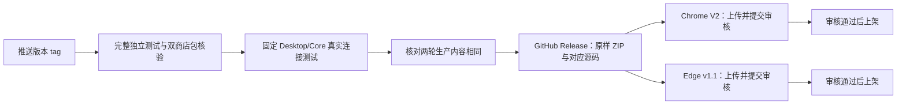

# Chrome 与 Edge 自动发布

首次上架后，推送正式版本标签（如 `1.0.1`，不加 `v`）会自动提交两家商店审核，通过后按商店设置上架。不是推送代码后立即生效。

## 配置一次

仓库 **Settings → Secrets and variables → Actions**。密钥放 Secrets，公开标识放 Variables；不要写入 workflow、仓库或日志。

| 类型     | 名称                          | 内容                                                                             |
| -------- | ----------------------------- | -------------------------------------------------------------------------------- |
| Secret   | `CHROME_SERVICE_ACCOUNT_JSON` | Google 服务账号下载的完整 JSON 密钥                                              |
| Secret   | `EDGE_CLIENT_ID`              | Edge Publish API Client ID                                                       |
| Secret   | `EDGE_API_KEY`                | Edge Publish API API Key                                                         |
| Variable | `CHROME_PUBLISHER_ID`         | Chrome 开发者后台 Publisher → Settings 的 Publisher ID                           |
| Variable | `CHROME_EXTENSION_ID`         | Chrome 商店详情页地址末尾的扩展 ID                                               |
| Variable | `EDGE_PRODUCT_ID`             | Partner Center Extension identity 的产品 GUID，不能填 Edge 商店地址末尾的扩展 ID |

### Chrome

1. 在 [Google Cloud](https://console.cloud.google.com/) 选择项目，启用 **Chrome Web Store API**。
2. IAM 和管理 → 服务账号：创建用于发布的服务账号。这一步不用授予 Cloud 项目 IAM 角色。
3. 在 [Chrome 开发者后台](https://chrome.google.com/webstore/devconsole/)的 Account（账号）区域，将该服务账号邮箱绑定到发布者。Google 目前每个发布者只支持一个服务账号。
4. Google Cloud → 服务账号 → 该账号 → 密钥 → 添加密钥 → 创建新密钥 → JSON。将完整内容保存到 `CHROME_SERVICE_ACCOUNT_JSON`。不要上传下载文件到代码仓库。
5. 从 Chrome 后台取得 Publisher ID，从已发布详情页取得扩展 ID，保存对应 Variables。

脚本按 [Google 官方 JWT 交换规范](https://developers.google.com/identity/protocols/oauth2/service-account#httprest)请求一小时 access token，仅使用 `chromewebstore` scope。不会使用个人账号、申请 Cloud 项目权限或将 token 写入附件。[Chrome 服务账号指南](https://developer.chrome.com/docs/webstore/service-accounts)

### Edge

1. [Partner Center](https://partner.microsoft.com/en-us/dashboard/microsoftedge/overview) → Microsoft Edge → **Publish API**。
2. 使用新版 API Key 体验，创建凭据，分别保存 Client ID 和 API Key。检查到期时间，定期更换 Secret。
3. 打开已有扩展的 Extension overview → Extension identity，复制 **Product ID** 到 `EDGE_PRODUCT_ID`。

接口使用 `Authorization: ApiKey` 和 `X-ClientID`；地址仍含 `/v1/`，认证方式是微软称为 v1.1 的新版体验。[微软说明](https://learn.microsoft.com/en-us/microsoft-edge/extensions/update/api/using-addons-api)

工作流使用 `chrome-store`、`edge-store` 两个 Environment，也支持以上仓库 Secrets/Variables。已有环境的部署规则必须允许正式版本 tag。需要全自动时不要配置人工 Required reviewers；若设置了审批，流程会在商店步骤等待维护者。

## 每次发版

1. 更新 `package.json`、锁文件、CHANGELOG 和 `docs/版本/<版本>.md`；审核测试步骤变化时同步 `scripts/store-certification-notes.txt`（2000 字符以内）。
2. 完成本地验收，提交到 main，再创建同版本的注解 tag 并推送；正式标签只能指向 main 的历史。
3. 在 **Browser standalone CI** 查看结果。格式、类型、全部单元、双商店 ZIP、完整无头独立 UI、真实连接和生产身份门禁全部成功后才发布。
4. Chrome/Edge 分别显示待审核或已提交状态，最终上架仍以商店后台和公开详情页为准。

发布复用独立 CI 的原样 ZIP；连接 CI 可生成容器摘要不同的 ZIP，但逐文件生产摘要必须完全一致。`SOURCE.json` 和 `connected-store-packages.json` 同时保留真实连接使用的 Desktop/Core 提交。不能重新构建发布包、替换附件或跳过连接门禁。固定 Desktop/Core 来源在 `ci.yml`，升级时一起修改并核验 Desktop 的 Core gitlink。该组合是测试基线，不代表所有平台的发行包均已验收。

## 失败与补发

- 两家商店独立执行，一家失败不取消另一家。先查看对应步骤和商店后台，再使用 **Re-run failed jobs**。
- Chrome 同一版本已待审核或已发布时，只读取状态，不重复上传；其他版本仍在审核时停止。
- Edge 暂无本脚本使用的“当前版本”读取接口。写请求超时或状态未知时，先检查已有草稿/操作 ID，不能直接重跑上传。状态查询可能返回 HTTP 200 或 202，只有正文 `status=Succeeded` 才继续。
- 认证失效、错 Product ID、包摘要不符、上传失败或未知状态都会阻断相应步骤。不会自动撤回审核、改可见性或覆盖公开标签。
- API 不修改商品介绍、截图、隐私政策或分发地区；这些变化仍在商店后台处理。手动 **Upload or resume Edge package** 与自动提交共用串行锁，默认只更新草稿。已有上传操作时填 `upload_operation_id` 可继续查询；确需送审才勾选 `submit_for_review`。恢复仍要求同源码的 main 独立、真实连接 CI 通过，并核对原样 ZIP，不修改已发布 tag。
- 本地脚本测试使用假响应，只证明调用顺序、签名与拒绝条件。配置 Secrets 后才能核验真实认证；没有新正式版本时不为测试上传或送审现有 `1.0.0`。
